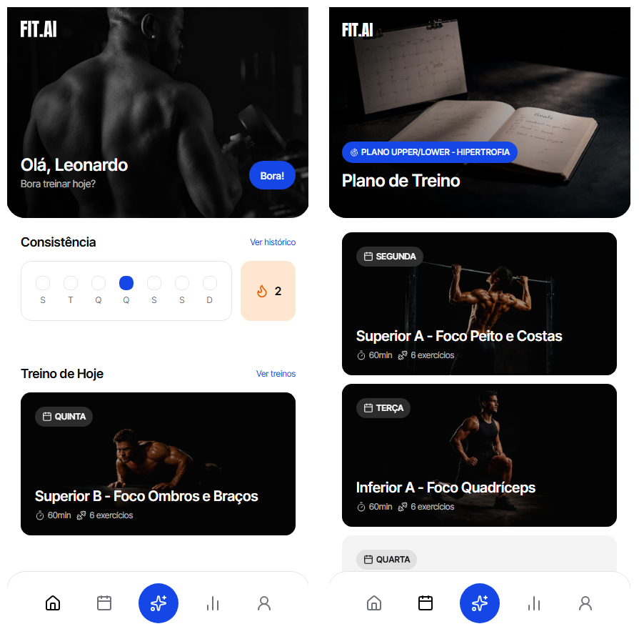
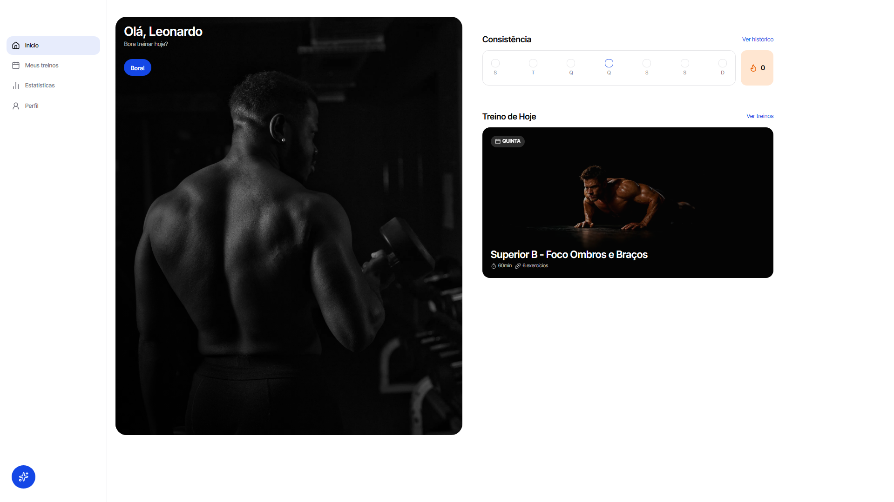

# Bootcamp Treinos Frontend

Frontend web da plataforma de treinos com inteligência artificial, desenvolvido para que os usuários possam gerar planos personalizados via assistente conversacional de IA, acompanhar a rotina diária de exercícios, registrar sessões e monitorar métricas corporais e de consistência.



## Tech Stack

- **Framework:** Next.js 16 (App Router, Server Components & Server Actions)
- **Biblioteca Front-End:** React 19
- **Linguagem:** TypeScript
- **Estilização:** Tailwind CSS v4 e Lucide React (ícones)
- **Componentes UI:** shadcn/ui e Radix UI primitives
- **Formulários e Validação:** React Hook Form e Zod (`@hookform/resolvers`)
- **Autenticação:** Better Auth Client (`better-auth/react`)
- **Inteligência Artificial & Streaming:** Vercel AI SDK (`ai` e `@ai-sdk/react`) com renderização em markdown via Streamdown
- **Gerenciamento de Estado de URL:** nuqs (query params type-safe para drawers e chat)
- **Cliente de API & CodeGen:** Orval (geração tipada de endpoints `fetch` via OpenAPI/Swagger)
- **Manipulação de Datas:** Day.js

## Principais features

- **Autenticação Social:** Login seguro e gerenciamento de sessão via Google OAuth com Better Auth.
- **Onboarding Guiado por IA:** Fluxo conversacional inicial com assistente inteligente para coleta de dados antropométricos e criação automatizada do primeiro plano de treino.
- **Assistente IA Integrado (Chat com Streaming):** Chat flutuante e responsivo para interagir com a IA, tirar dúvidas e solicitar a montagem ou ajuste de planos de treino em tempo real.
- **Dashboard Principal:**
  - Visão imediata do treino do dia atual ou indicação de descanso.
  - Contador de dias consecutivos de treino (_streak_ com ícone de chama).
  - Rastreador visual de consistência semanal (_Consistency Tracker_).
  - Gaveta (_Sheet_) para inspeção rápida dos exercícios do dia selecionado.
- **Visualização de Planos de Treino:**
  - Grade completa dos 7 dias da semana (Segunda a Domingo).
  - Diferenciação visual clara entre dias de treino ativo e dias de descanso (_Rest Day_).
- **Execução e Acompanhamento de Treino:**
  - Detalhamento de cada exercício: grupos musculares, séries, repetições e tempo de descanso.
  - Ações no servidor (_Server Actions_) para iniciar a sessão e registrar a conclusão com persistência em tempo real.
- **Estatísticas e Consistência (Stats):**
  - Banner informativo de streak atual.
  - Heatmap trimestral de frequência de treinos por dia.
  - Cards com total de treinos concluídos e tempo total exercitado (convertido em horas e minutos).
- **Perfil do Usuário:**
  - Exibição de avatar e dados cadastrados: peso (convertido para kg), altura (cm), percentual de gordura corporal (%) e idade.
  - Opção de encerramento seguro de sessão (_logout_).
- **Interface Responsiva:**
  - Otimizada tanto para dispositivos móveis (com barra de navegação inferior `BottomNav`) quanto para desktop (com barra lateral retrátil `SidebarNav`).



## Regras de Negócios e Fluxos

### Proteção de Rotas e Redirecionamentos

- **Não autenticado:** Tentativas de acesso a rotas privadas (`/`, `/workout-plans/*`, `/stats`, `/profile`, `/onboarding`) redirecionam o usuário para `/auth`.
- **Já autenticado:** Usuários logados que tentam acessar `/auth` são redirecionados automaticamente para `/`.
- **Pendência de Onboarding:** Se o usuário autenticado ainda não tiver perfil físico cadastrado ou não possuir um plano de treino ativo, é redirecionado automaticamente para a página `/onboarding`.

### Conversão e Formatação de Dados

- **Peso Corporal:** Os valores recebidos da API em gramas (`weightInGrams`) são convertidos para quilogramas (`kg = weightInGrams / 1000`) para exibição no perfil.
- **Duração de Treino:** A soma dos segundos registrados nas sessões é formatada no padrão legível `XhYYm` (ex: `2h15m`).

### Sincronização e Revalidação em Tempo Real

- A inicialização e conclusão de treinos utilizam Server Actions (`startWorkoutAction` e `completeWorkoutAction`) combinadas com `revalidatePath`, garantindo que o dashboard, a lista de dias e o status do treino sejam atualizados sem requisições client-side manuais.

### Estado em URL com nuqs

- Parâmetros como o dia selecionado (`?day=...`) ou abertura e mensagens iniciais do chat (`?chat_open=true&chat_initial_message=...`) são gerenciados via URL, permitindo links compartilháveis e navegação fluida com histórico do navegador.

## Instalação local

- Clone o repositório e entre na pasta:

```bash
git clone <url-do-repositorio>
cd bootcamp-treinos-frontend
```

- Instale as dependências usando `pnpm`:

```bash
pnpm install
```

- Configure as variáveis de ambiente copiando o arquivo `.env.example` para `.env`:

```bash
cp .env.example .env
```

Configurações padrão:

```env
NEXT_PUBLIC_API_URL="http://localhost:8080"
NEXT_PUBLIC_BASE_URL="http://localhost:3000"
```

- (Opcional) Gere ou atualize os clientes tipados da API com Orval (certifique-se de que a API esteja rodando):

```bash
pnpm dlx orval
```

- Inicie o servidor de desenvolvimento:

```bash
pnpm dev
```

Acesse a aplicação em: **[http://localhost:3000](http://localhost:3000)**

## Estrutura do Projeto

```
app/
├── _components/            # Componentes globais da aplicação (BottomNav, SidebarNav, Chat, etc.)
├── _lib/                   # Módulos de infraestrutura e utilitários
│   ├── api/fetch-generated # Cliente tipado de API gerado automaticamente pelo Orval
│   ├── auth-client.ts      # Instância do Better Auth Client
│   └── fetch.ts            # Mutator customizado com injeção de cookies e credenciais
├── auth/                   # Página e componentes de login / autenticação
├── onboarding/             # Fluxo inicial de onboarding interativo via chat com IA
├── profile/                # Página e ações de visualização de perfil e logout
├── stats/                  # Página de estatísticas, heatmap e métricas de consistência
├── workout-plans/          # Visualização de planos e dias de treino
│   └── [id]/
│       ├── _components/    # Componentes do plano de treino (listas, cards, drawers)
│       └── days/[dayId]/   # Detalhes do dia de treino, exercícios e Server Actions
├── globals.css             # Configurações de tema e estilos globais com Tailwind CSS
├── layout.tsx              # Root Layout da aplicação com fontes e metadados
└── page.tsx                # Página inicial (Dashboard / Home)
components/
└── ui/                     # Primitivos de UI baseados no shadcn/ui (Button, Card, Sheet, etc.)
public/                     # Recursos visuais estáticos (banners, logos e ícones)
orval.config.ts             # Configuração de geração do cliente API a partir do Swagger
```

## Integração com a API

Este frontend consome a API do backend desenvolvida em Fastify. Para garantir o funcionamento correto de autenticação, geração de treinos com IA e consulta de dados, certifique-se de que a **Bootcamp Treinos API** esteja em execução em `http://localhost:8080`.
